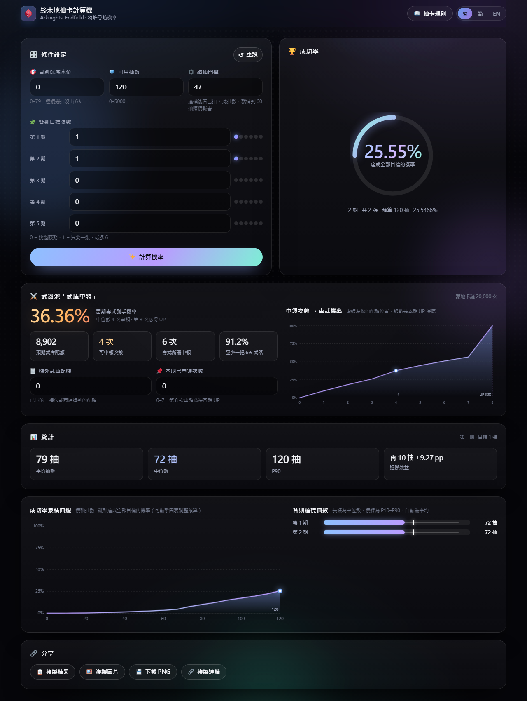

# 終末地抽卡機率計算機（干員池）

《明日方舟：終末地》「特許尋訪」多期連抽的成功率計算器。純靜態網頁：`index.html` + 一個 25 KB 的
standalone WebAssembly 引擎，**沒有任何前端框架、沒有 CDN 依賴也能運作**（`file://` 直接開也行）。



- 🧮 多期目標、保底水位、120 大保底、60 抽情報書、240 信物全部納入計算
- 📊 成功率累積曲線 + 各期達標抽數統計（平均／中位數／P90／邊際效益）
- 🔗 一鍵分享：複製文字、複製圖片、下載 PNG、複製連結（狀態可還原）
- 🌐 繁體中文 / 简体中文 / English 三語切換
- 📖 內建抽卡規則說明（三語）
- ✨ 動態背景、指針式機率環、可點擊的圖表（點一下圖表即調整預算）

---

## 1. 目前規則（2026/10，版本「丹青渡」）

幹員尋訪共通：6★ **0.80%**、5★ 8.00%、4★ 91.20%；每 10 抽必含 5★ 以上。

| 機制 | 規則 | 是否跨池繼承 |
| --- | --- | --- |
| 軟保底 | 連續 65 抽沒 6★ → 第 66 抽起每抽 **+5 個百分點**（66→5.8%、79→70.8%） | ✅ 水位繼承 |
| 小保底 | 第 **80** 抽必 6★ | ✅ 跨特許尋訪繼承 |
| 大保底 | 本期第 **120** 抽若尚未取得當期 UP → 該抽必為 UP 6★ | ❌ 不繼承、每期一次、抽到 UP 即失效 |
| 6★ 組成 | 當期 UP 佔 **50%**；歪掉後下一次仍 50%（沒有補正） | — |
| 累計 30 抽 | 送同池 **10 抽加急招募**：只吃基礎機率，**不計**保底、**不計**累計次數 | 只有本期有效 |
| 累計 60 抽 | 【尋訪情報書】→ **下一期**特許尋訪專屬十連（會計入下期保底） | 下一期用，跳過就作廢 |
| 每累計 240 抽 | 當期 UP 角【信物】×1（240/480/720… 可重複） | 每期重新計 |

武器池（未納入本計算機）：「武庫申領」一次消耗 1,980 武庫配額、給 10 件武器（必含 5★ 以上），
6★ 武器基礎 4%、每 4 次申領（40 抽）必 6★、每 8 次申領（80 抽）必當期 UP，獎勵每期清零不繼承。

> 官方來源：`endfield.hypergryph.com/news/8548`（特許尋訪獎勵原文）、`/news/4783`（武庫申領說明）。
> 保底數字為社群多方交叉一致的整理（官方僅在遊戲內公布機率細節）。遊戲內「抽卡規則」彈窗有完整版本。

---

## 2. 檔案結構

| 檔案 | 說明 |
| --- | --- |
| `index.html` | 頁面骨架（語意標記 + `data-i18n` 掛鉤） |
| `styles.css` | 設計系統：玻璃卡片、動態背景、動畫、RWD、`prefers-reduced-motion` |
| `i18n.js` | 三語字典 + 規則內文 |
| `app.js` | 狀態機：輸入 → 引擎 → 結果／統計／圖表／分享，URL 狀態還原 |
| `charts.js` | 純 SVG 圖表（曲線圖、抽數分布），含 hover / click 互動 |
| `share.js` | Canvas 產生分享圖、剪貼簿、下載、複製連結 |
| `gacha.js` | wasm 載入器（`Gacha.init / calculate / setThreshold / bannerStats`） |
| `gacha.cpp` | **引擎原始碼**（規則、單池結局分布 DP、多池 DP、統計接口） |
| `gacha.wasm` | 由 `gacha.cpp` 編出的 standalone wasm（無任何 import） |
| `gacha-wasm-b64.js` | 同一份 wasm 的 base64 內嵌版，讓 `file://` 直開也能跑 |
| `tests/` | 測試（引擎數值、i18n、DOM 冒煙、瀏覽器載入路徑） |
| `tools/build.js` | 跨平台建置入口（Vercel / CI 安全跳過） |
| `tools/build.ps1`, `tools/build.cmd` | Windows 上實際編譯 wasm 的腳本 |
| `vercel.json`, `.vercelignore` | Vercel 靜態部署設定 |
| `docs/` | 預覽圖 |

---

## 3. 模型

1. **單池結局分布**：以 `(保底水位, 已得張數, 是否已取得 UP)` 為狀態逐抽推進，
   記錄「這一池花了幾抽、收池時的保底水位、有沒有拿到情報書」及其機率。
2. **多池 DP**：狀態 = `(剩餘預算, 保底水位)`，逐期推進。
   - 情報書只能用在「緊接著的下一期」；下一期被跳過就當場作廢。
   - 剩餘預算 < 60 時「補到 60 抽」買不起 → 該狀態達標就停手，不會把整條路徑丟掉。
3. **策略門檻**（UI 可調）：達標時若已抽 ≥ 門檻且未滿 60 抽，就繼續補到 60 抽賺情報書。
   實測最佳區間 45–50（差異常 < 0.06 個百分點）；設 0（永不提前停手）在預算緊張時反而更差。

### 統計與圖表怎麼算

- **成功率累積曲線**：對 0…預算之間取樣（固定點 + 等分點，時間上限 650 ms）逐點精算，
  可 hover 讀值、點擊直接把該抽數設為預算。
- **各期達標抽數**：引擎的 `bannerMean` / `bannerQuantile` 直接由「達標即停」的結局分布算出，
  顯示平均、中位數、P10–P90。
- **邊際效益**：`P(預算+10) − P(預算)`（單次計算超過 90 ms 時自動略過，避免卡頓）。

### 已知限制

- 只建模**特許尋訪**。1.2 版起的復刻混池「輝光慶典」（保底獨立、120 抽給四人自選、60 抽送基礎券）
  規則不同，用本工具算會不準。
- 沒有「本期已累計抽數」輸入：120 大保底與 240 信物一律假設從本期第 0 抽開始算。
- 免費十連以「10 次獨立 0.4% 抽 UP」的二項分布近似（官方明訂不吃保底，故等效）。
  若免費十連抽到 UP，會正確讓 120 大保底失效。

---

## 4. 建置與部署

### 重新編譯 wasm（只有改了 `gacha.cpp` 才需要）

需要 emsdk（預設路徑 `C:\emsdk`，可用環境變數 `EMSDK_ROOT` 覆寫）。

```
npm run build        # 跨平台入口：找不到 emsdk 就跳過，不會讓建置失敗
npm run build:wasm   # 強制重建（--force）
```

`tools/build.js` 會依序做三件事：`clang -c gacha.cpp`（`-O3 -msimd128`）→ `emcc` 只做連結變成
`gacha.wasm` → 產生 `gacha-wasm-b64.js`。在沒有 emsdk 的機器（Vercel / Linux CI）會直接跳過並沿用
已提交的產物。

> 為什麼分兩步：本專案的開發環境會封鎖 python `tempfile.mkdtemp()` 建的目錄，
> 而 emcc 內部會用暫存目錄編譯，因此改成先自己編 `.o`、再讓 emcc 只連結。
> 另外 `-fno-exceptions` 會讓 libc++ 連進 stdio（wasm 會出現 `wasi_snapshot_preview1` import），
> 所以不要加。

### 部署（Vercel / GitHub Pages）

這是純靜態網站：`gacha.wasm` 與 `gacha-wasm-b64.js` 都已進版控，**雲端不需要建置**。

- `vercel.json`：`outputDirectory: "."`、`gacha.wasm` 補上 `Content-Type: application/wasm`。
- `.vercelignore`：排除 `package.json`、`tools/`、`tests/`，讓 Vercel 不會去跑 `npm run build`
  （之前的失敗就是 Vercel 在 Linux 上執行 Windows 的 `tools\build.cmd`）。
- GitHub Pages：Settings → Pages → 選 `main` / root 即可。

---

## 5. 測試

```
node tests/run.js              # 引擎數值（含蒙地卡羅，約 10 秒）
node tests/run.js --perf       # 加上效能 benchmark
node tests/check-i18n.js       # 三語字典一致性 / 佔位符 / 規則段落
node tests/check-dom.js        # 迷你 DOM 冒煙：真的跑 charts.js 與 share.js + HTML 契約
node tests/check-browser-path.js   # 模擬瀏覽器（無 process）走 base64 內嵌路徑
```

| 組 | 內容 | 容差 |
| --- | --- | --- |
| A 解析解 | 1 抽 = 0.4%、n≤30 抽 = `1-0.996^(n+10)`、墊 79 抽 +1 = 50%、120 抽 = 100% | 1e-12 |
| B 參考模型 | 86 組情境（目標 0–6 張、水位 0–79、預算 0–3000、門檻 0–59、1–5 池） | 1e-9 |
| C 蒙地卡羅 | 6 組情境，每組 30–40 萬次模擬 | 3σ |
| D 邊界 | 預算 0、全 0 目標、超界夾取、單調性 | 精確 |
| F 統計接口 | `bannerMean` / `bannerQuantile` 對照參考模型（5 目標 × 3 水位） | 1 抽 / 1% |
| 靜態 | i18n key 三語齊全、index.html 的 id 與資源都存在、圖表與分享圖能實際繪製 | — |

目前狀態：**169 項引擎/統計測試 + i18n + DOM 契約全部通過**，引擎與參考模型最大偏差 **6e-15**。

---

## 6. 效能

`node tests/run.js --perf`（Windows / wasm SIMD）：

| 情境 | 時間 |
| --- | --- |
| 單池 1 隻 / 120 抽 | 0.1–1 ms |
| 3 池 3/2/1 隻 / 600 抽 | 22–26 ms |
| 最壞：5 池各 6 隻 / 1000 抽 | 約 0.35 s |
| 最壞：5 池各 6 隻 / 5000 抽 | 約 0.5–0.65 s（暖快取約 0.27 s） |

最佳化手段：單池 DP 提前截斷（存活質量 < 1e-13）、結局表快取、多池 DP 稀疏化 +
以 `[水位][剩餘預算]` 佈局做連續 SAXPY（wasm SIMD 向量化）、最後一期改用 cost CDF 一次結算、
預算超過「各期 1−1e-12 分位總和」時直接回 1。

---

## 7. 版本差異

| # | 問題（v1，2026-05-28） | 影響 |
| --- | --- | --- |
| 1 | 免費十連抽到 UP 後沒設「已取得 UP」旗標 → 120 大保底仍然生效 | **高估**最多 +1.31 pp |
| 2 | 情報書無條件給「下一個有目標的池」，即使中間那期被跳過 | 高估最多 +1.95 pp |
| 3 | 240 信物只算一次（規則為每 240 抽都給） | 低估約 0.10 pp |
| 4 | 達標後強制補到 60 抽，未檢查預算買不買得起 | **低估**（預算 55、門檻 0：0% → 2.70%） |
| 5 | 最壞情況 11.9 s | 0.5 s |
| 6 | Emscripten 黏合層 + `Module.setValue` / `_malloc` | 換成 4 KB 自寫載入器，無記憶體操作 |
| 7 | 只有單一深色介面、無圖表／分享／i18n | v2：三語、圖表、分享圖、規則彈窗 |

---

## 8. 授權 / 致謝

程式碼可自由使用。遊戲名稱、幹員與相關素材版權屬上海鷹角網絡。本工具為非官方，
機率來自數學模型推算，僅供參考。Emoji 使用系統字型，若可連上 CDN 會自動換成
[Twemoji](https://github.com/jdecked/twemoji)（CC-BY 4.0）的彩色圖檔。
